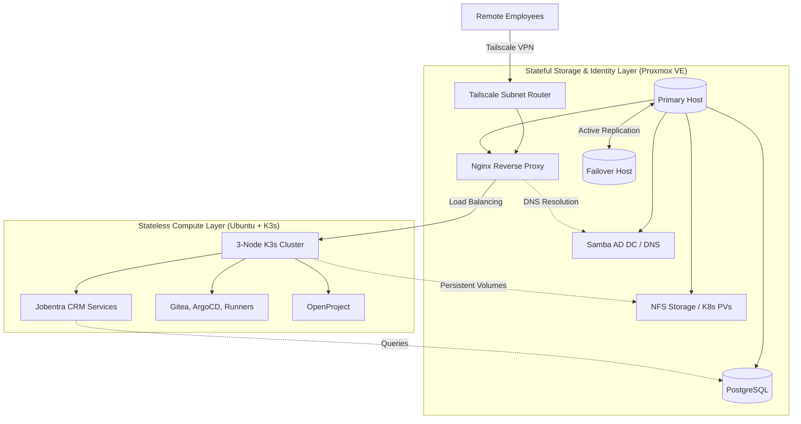

# Jobentra – Hybrid Infrastructure Architecture

A high-availability, bare-metal micro-cloud designed to host the internal operations, CRM, and developer tooling for Jobentra (a recruitment and staffing agency).

> **Architectural Focus:** This infrastructure enforces a strict separation of concerns by decoupling ephemeral, stateless compute workloads from stateful storage and identity management.

## 🏗️ Architecture Overview

---

## 🧠 Core Architectural Decisions

### 1. Strict Stateful vs. Stateless Decoupling

Running databases inside Kubernetes can introduce unnecessary complexity regarding data persistence and quorum loss. To prevent this:

* **Stateless (K3s):** The 3-node Kubernetes cluster is entirely ephemeral. It runs the CRM microservices and developer tooling (Gitea, OpenProject, CI/CD). If a K3s node dies, it can be wiped and reprovisioned without any data loss.
* **Stateful (Proxmox):** All persistent data (PostgreSQL, Samba AD DC, NFS shares for K8s Persistent Volumes) runs on dedicated Proxmox VE hypervisors outside the Kubernetes cluster.

### 2. High Availability (HA) & Replication

To ensure business continuity, the stateful layer consists of a Primary and a Fallback node.

* **Active Replication:** The primary Proxmox node replicates data continuously to the fallback node (ThinkCentre).
* **Service Redundancy:** The Samba Active Directory Domain Controller operates as a replicated member, while NFS and PostgreSQL are prepared for rapid failover in case of a primary hardware fault.

### 3. Zero-Trust Networking & Custom Routing

* **Tailscale Subnet Routing:** Instead of running VPN clients on every individual virtual machine or Kubernetes node, Tailscale is installed directly on the Proxmox host. Operating as a **Subnet Router**, it securely exposes the internal management and service subnets to authorized remote employees without exposing any ports to the public internet.
* **DNS Round Robin & Load Balancing:** External routing is handled natively rather than relying on internal K8s ingress controllers. The Samba AD DC acts as the central DNS server, utilizing DNS Round Robin to resolve internal domains. Traffic is then routed through the primary Nginx Reverse Proxy (hosted on Proxmox), which acts as the load balancer across the stateless K3s worker nodes.

---

## 💻 Hardware & Bare-Metal Stack

The entire infrastructure runs on highly efficient, low-power micro nodes, maximizing compute density while keeping thermal output and energy consumption minimal.

| Layer | Hardware / Node | Specs | OS / Platform | Roles |
| --- | --- | --- | --- | --- |
| **Stateful (Primary)** | Fujitsu Esprimo Mini PC | Intel Core i3, 16GB RAM, 250GB SSD | Proxmox VE | Samba AD DC, PostgreSQL, NFS Server, Nginx Proxy |
| **Stateful (Fallback)** | Lenovo ThinkCentre Tiny | Intel Core i3, 16GB RAM, 180GB SSD | Proxmox VE | Active Replication Target, Failover Services |
| **Stateless (Worker 1)** | Fujitsu Esprimo Mini PC | Intel Core i3, 8GB RAM, 128GB SSD | Ubuntu Server + K3s | K8s Worker, CRM Services, OpenProject |
| **Stateless (Worker 2)** | Fujitsu Esprimo Mini PC | Intel Core i3, 8GB RAM, 128GB SSD | Ubuntu Server + K3s | K8s Worker, Gitea, ArgoCD |
| **Stateless (Worker 3)** | Fujitsu Esprimo Mini PC | Intel Core i3, 8GB RAM, 128GB SSD | Ubuntu Server + K3s | K8s Worker, CI/CD Runners |

---

*Maintained for internal infrastructure operations and GitOps deployment testing.*
