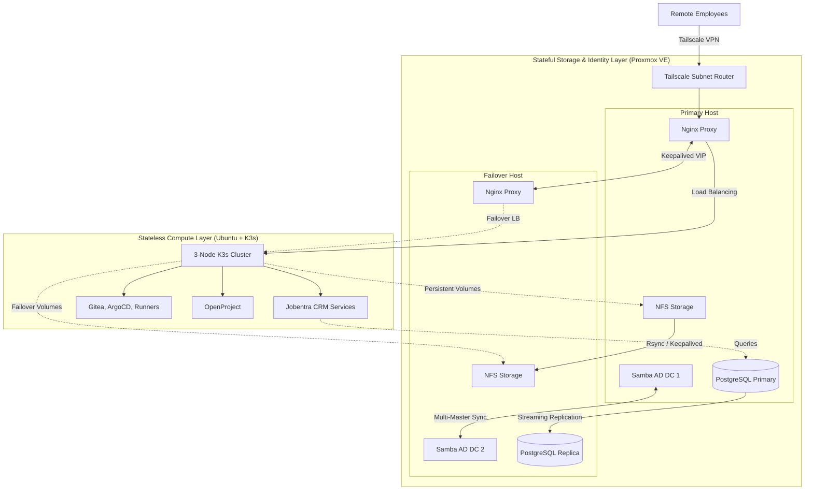

# Jobentra – Hybrid Infrastructure Architecture

A high-availability, bare-metal micro-cloud designed to host the internal operations, CRM, and developer tooling for Jobentra (a recruitment and staffing agency).

> **Architectural Focus:** This infrastructure enforces a strict separation of concerns by decoupling ephemeral, stateless compute workloads from stateful storage and identity management, utilizing application-level active-passive replication for maximum resilience.

## 🏗️ Architecture Overview

---

## 🧠 Core Architectural Decisions

### 1. Strict Stateful vs. Stateless Decoupling

Running databases inside Kubernetes can introduce unnecessary complexity regarding data persistence and quorum loss. To prevent this:

* **Stateless (K3s):** The 3-node Kubernetes cluster is entirely ephemeral. It runs the CRM microservices and developer tooling (Gitea, OpenProject, CI/CD). If a K3s node dies, it can be wiped and reprovisioned without any data loss.
* **Stateful (Proxmox):** All persistent data (PostgreSQL, Samba AD DC, NFS shares for K8s Persistent Volumes) runs on dedicated Proxmox VE hypervisors outside the Kubernetes cluster.

### 2. Application-Level High Availability (HA)

Instead of relying on simple block-level storage replication, the stateful layer is engineered for application-level redundancy across two independent Proxmox hosts:

* **Database Replication:** PostgreSQL is configured with a dedicated replicator role, streaming transactions continuously from the primary instance to the hot-standby failover node.
* **Identity & DNS Multi-Master:** The Samba Active Directory Domain Controller runs on both hosts as domain members, automatically syncing DNS and identity data. Both nodes act as active DNS resolvers.
* **Storage & Routing Failover:** NFS storage and the Nginx Reverse Proxy instances are kept in sync via `rsync` and utilize `Keepalived` to float virtual IP addresses (VIPs). If the primary host goes offline, the failover host seamlessly assumes the routing and storage endpoints.

### 3. Zero-Trust Networking & Custom Routing

* **Tailscale Subnet Routing:** Instead of running VPN clients on every individual virtual machine or Kubernetes node, Tailscale is installed directly on the Proxmox host. Operating as a **Subnet Router**, it securely exposes the internal management and service subnets to authorized remote employees without exposing any ports to the public internet.
* **DNS Round Robin & Load Balancing:** External routing is handled natively rather than relying on internal K8s ingress controllers. The Samba AD DC acts as the central DNS server, utilizing DNS Round Robin to resolve internal domains. Traffic is then routed through the active Nginx Reverse Proxy, which acts as the load balancer across the stateless K3s worker nodes.

---

## 💻 Hardware & Bare-Metal Stack

The entire infrastructure runs on highly efficient, low-power micro nodes, maximizing compute density while keeping thermal output and energy consumption minimal.

| Layer | Hardware / Node | Specs | OS / Platform | Roles |
| --- | --- | --- | --- | --- |
| **Stateful (Primary)** | Fujitsu Esprimo Mini PC | Intel Core i3, 16GB RAM, 250GB SSD | Proxmox VE | Active AD DC, Primary PostgreSQL, NFS, Nginx, Tailscale |
| **Stateful (Failover)** | Lenovo ThinkCentre Tiny | Intel Core i3, 16GB RAM, 180GB SSD | Proxmox VE | Secondary AD DC, PostgreSQL Replica, Keepalived Failover |
| **Stateless (Worker 1)** | Fujitsu Esprimo Mini PC | Intel Core i3, 8GB RAM, 128GB SSD | Ubuntu Server + K3s | K8s Worker, CRM Services, OpenProject |
| **Stateless (Worker 2)** | Fujitsu Esprimo Mini PC | Intel Core i3, 8GB RAM, 128GB SSD | Ubuntu Server + K3s | K8s Worker, Gitea, ArgoCD |
| **Stateless (Worker 3)** | Fujitsu Esprimo Mini PC | Intel Core i3, 8GB RAM, 128GB SSD | Ubuntu Server + K3s | K8s Worker, CI/CD Runners |

---

*Maintained for internal infrastructure operations and GitOps deployment testing.*
